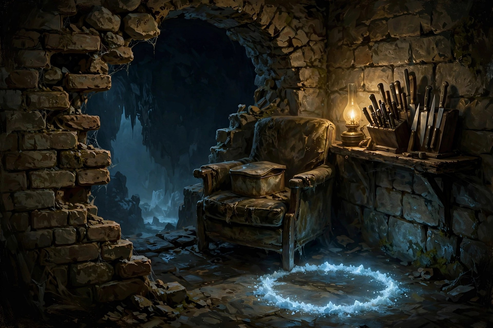

# Dunfinity: the recipe box (deep dive)

Status: **draft 2, decisions made, no code.** Part of [dunfinity-plan.md](dunfinity-plan.md) (decision D12, gap G6).

*Concept sketch (Muse via OpenRouter, 1 ¢).*

## Decisions (Arnd, 2026-10-14)

| # | Decision |
|---|---|
| R1 | Skills are **cooked** (bought) from grandma's recipe tin. Using them improves them (practice) |
| R2 | Currency is **infused salt**, not ordinary salt (ordinary salt is too common to feel special) |
| R3 | You cook **at a fire**, anywhere safe; the infused-salt circle in the strange room is the one always-safe fire |
| R4 | **Practice gates** on advanced cards |
| R5 | **Chapters open with depth** |
| R6 | **Generated lost cards** from about level 60 |
| R7 | **The tin is tongue-in-cheek and fun**, not mechanistic. See section 2 |

---

## 1. The object

In the strange small room, on the armchair, sits a dented biscuit tin full of index cards in grandma's handwriting. It is the first thing you pick up, before the knife block.

Each card is an ability or passive, written as a recipe: a title, a little drawing, "you'll need", the method, and grandma's notes in the margin.

---

## 2. Voice: grandma is funny

The tin is the game's main narrator, so it carries most of the humour. Grandma is dry, practical, slightly scandalous and completely unimpressed by monsters. She has seen worse; she was married to your grandfather.

**Rules for the writing:**
- **Short.** The card front is a title and one line. The method on the back is three lines at most. Numbers live in a separate tooltip, never in her text.
- **Kitchen logic applied to violence.** The joke is the mismatch: a recipe's calm tone for something horrifying.
- **Funny, never silly about danger.** The dungeon is still deadly. She jokes because she survived it.
- **Every card is also story.** Her notes drop hints about her life down there: names, dates, a bridge she won't talk about.
- **Her handwriting ages.** Early cards (the basics) are in a careful, older hand. Deeper chapters and lost cards are in a young, fast, reckless hand from the 1960s. Without a word of exposition, the player realises she went *down* first and wrote the safe recipes *later*.
- **Rank-ups are punchlines.** Cooking a card again adds a new line, often a short one.
- **Physical card details:** grease stains, crossed-out lines, a "TRIED ✓" stamp, a pressed flower, a burn mark on the fire cards, a child's drawing on one (yours, from when you visited once, 30 years ago).

**Sample cards (first pass):**

> **Hold It Properly** *(Kitchen Work, rank 1)*
> *You'll need:* one kitchen knife (any, I have plenty), three pinches of the good salt.
> *Method:* Pointy end goes in the other fellow. That's it. Took your grandfather two years.
> *Rank 2:* Now faster. *Rank 3:* Show-off.

> **Second Helpings** *(Throwing)*
> There are always more knives in the block. Don't ask me how. I stopped asking in 1974.
> *Method:* Throw one. Then another. Don't throw the bread knife, it's sentimental.

> **Duck** *(Footwork)*
> *Serves:* one coward, alive.
> *Method:* When something big swings at you, don't be there. Dust yourself off afterwards, you're not an animal.

> **Kneading** *(Climbing)*
> Like kneading dough, except the dough is a cliff and if you stop you die. Warm up first.

> **Sunday Candle** *(Light)*
> *Method:* Light it. Throw it. Things that live in the dark hate it the way your uncle hates vegetables.

> **Chicken Soup** *(Grandma's Remedies)*
> Cures everything except death, and I've had my suspicions about that too.

> **Tiptoe** *(Quiet)*
> Like coming home late in 1962. My mother never found out. Neither will they.

> **Flambé** *(Fire & Frost)*
> *Method:* Infused salt in the pan, pan at the goblin. Stand back. Further. *Further.*
> *(Margin, scorched:)* Eyebrows grow back. Mostly.

> **Way Home** *(Way Home: this is Recall)*
> For when you've overstayed your welcome. Close your eyes, think of my armchair.
> Do NOT bring back anything that is still moving. *(Underlined three times.)*

> **Salt Line** *(lost card, torn out, young handwriting)*
> They won't cross it. Mostly.
> *(Smudged:)* Except the tall one. Must find out about the tall one.

> **???** *(generated lost card, level 70+, written in a glyph script nobody can read; grandma's note clipped to it)*
> No idea what this does. Tastes of copper. Try it on someone you don't like.

---

## 3. Two axes: cooking and practice

| Axis | What it does | Source |
|---|---|---|
| **Cooking** (buying) | **Unlocks** a card | New |
| **Practice** (use) | **Improves** it: damage, cost, cooldown, reliability | Norgo's use-based skills and scaling (`combat.ts`) |

Practice also gates advanced cards ("Rending Cut" needs Knife practice 25). Only advanced cards are gated and the numbers stay low, so it never feels like grinding.

---

## 4. The currency: infused salt

- **What it is:** pale blue, faintly glowing salt crystals, infused with whatever lives down there. Ordinary salt from the kitchen does nothing (players will try, so the game should say so: grandma has a card for that. *"Not THAT salt. Honestly."*).
- **Where it comes from:** it forms where something happens for the first time: a creature you've never killed, a formation you've never entered, a new depth, a landmark, a lost card, one of grandma's camps. It drifts into the tin like iron filings to a magnet.
- **Rewards variety, not grinding:** the fifth goblin of a kind gives a little, the fiftieth nothing.
- **Ties together:** the salt-mine strata at the top (the miners were after it, and something went wrong); the infused-salt circle in the strange room; the nobody becoming "worth their salt".
- Not tradeable, not loot. Only the tin holds it.

---

## 5. Where you cook: at a fire

You light a small fire anywhere safe (no enemy aware of you) or use the inhabitants' hearths and braziers. Fires are checkpoints in the dark, a moment of rest and a decision point. They also make light, which attracts things; in Hunted mode a fire raises Heat. The infused-salt circle in the strange room is the one fire that is always safe.

---

## 6. The tree: about 90 cards in 13 chapters

Norgo's 202 abilities are too many for a permadeath run (a run cooks maybe 15–40 cards). Some don't fit at all: digging contradicts permanent rock, and settlement-life skills matter little underground.

Every chapter is **open from the start**, so every way of playing has its first cards at once. Depth opens a chapter's **stronger cards**: they sit behind a divider inside the chapter until one of the family has been deep enough (`Card.opens`).

**Why (Arnd, 2026-10-15):** players like certain play styles. Gating whole chapters by depth made a mage-minded player wait until level 15 for the first fire.

| Chapter | From Norgo | Starter cards (level 0) | Deeper cards open at |
|---|---|---|---|
| **Kitchen Work** (knives) | blades | Hold It Properly | 5, 10, 15, 25 |
| **Throwing** | throwing | Second Helpings | 5, 10, 15, 25 |
| **Footwork** | acrobatics, athletics | Duck, Spring in Your Step | 5, 10, 15, 25 |
| **Climbing & Water** | climbing, swimming | Kneading | 5, 10, 15, 25 |
| **Light** | luminism, parts of lore | Sunday Candle | 5, 10, 15, 25 |
| **Grandma's Remedies** | vitae, herbalism, cooking, survival | Chicken Soup | 5, 10, 15, 25 |
| **Heavy Things** | axes, blunt, polearms | Tenderising | 5, 10, 15, 25 |
| **Quiet** | stealth, lockpicking | Tiptoe | 5, 10, 15, 25 |
| **Way Home** (Recall, wards, traps, maps) | runecraft, lore | Way Home | 5, 10, 15, 25 |
| **Guard** | shields, armour | Pot Lid | 5, 10, 15, 25 |
| **Fire & Frost** | pyromancy, cryomancy | Stove Flame, Cold Larder | 5, 10, 15, 25 |
| **Force** | kinesis, gravitas | Rolling Pin | 5, 10, 15, 25 |
| **The Garden** (added 2026-10-16, Arnd's seed idea) | herbalism, animism | Snapdragons (a tossed seed comes up and bites the nearest thing, you too) | 5, 10, 15, 25 |

**The salt-worker (mage) path starts in the kitchen.** The infused salt is already magic; grandma's first fire and frost are household: *Stove Flame* (a match and a pinch of salt: a short gout of flame ahead), *Cold Larder* (a breath of the larder's cold: things nearby slow down), and *Rolling Pin* (Force: a shove that sends things back without touching them). The big spells come deeper in the same chapters.

**Paths on the first page:** the tin's first page names one starter per way of playing (the cook: Kitchen Work; the sneak: Quiet; the thrower: Throwing; the salt-worker: Fire & Frost), so a new player sees the paths, not just a list.

Dropped or folded in: mining, woodcutting, foraging, tracking, smithing (field repair stays), tailoring, enchanting, barter, persuasion, intimidation. Geomancy and umbramancy become lost-card material. Animism (taming) stays out for now.

**Ranks:** a card can be cooked again (rank 2, 3) to change *how* it works; practice changes the numbers. **Slots:** 6 active cards on desktop and on the iPad touch cluster; passives are free.

---

## 7. Lost cards

Torn-out pages, cards grandma never finished, recipes of other peoples. Found deterministically per stratum (grandma's old camps, the inhabitants' places, landmarks), then cooked like any other card. Scale's superpowers and Norgo's geomancy and umbramancy end up here.

On death, found lost cards stay on the corpse and get looted like everything else; a denizen may **use one against you**. The tin always returns to the armchair with only the core cards.

**Generated lost cards** (from about level 60): Norgo's abilities are recipes of composable ops (`strike`, `projectile`, `area`, `zone`, `dash`, `effect`, `summon`...), so the stratum genome can compose new abilities from them, named in the stratum's procedural language. A **power budget** per depth keeps them balanced. Grandma's notes on these are guesses ("Tastes of copper").

---

## 8. A first run, as an example

1. The tin holds three pinches of infused salt. You cook **Hold It Properly** at the circle.
2. Level 1, the quarry: first rats, first slime, the first big quarry hall: salt. At an old miners' brazier you cook **Duck**.
3. Level 3: you cook **Kneading** to climb further.
4. Level 5: the dividers for Heavy Things and Quiet open.
5. Level 8: Way Home opens. You save up for **Way Home**, your first big purchase.
6. Level 11: one of grandma's camps, in a collapsed chamber: a lost card, **Salt Line**.
7. You die on level 14. Your corpse keeps the knife, an axe and Salt Line. The next nobody finds the tin back on the armchair.

---

## 9. Generated media (note)

Image, music and sound generation is available through OpenRouter (key in the environment as `OPEN_ROUTER_KEY`, as in Scale):
- **Images:** `meta/muse-image` via `POST /api/v1/images/generations`, 1 ¢ per 1920×1280 image. Prompt explicitly for "no text, no letters" (it likes painting text). Good for concept art, card illustrations and loading screens.
- **Music:** Lyria 3 (`google/lyria-3-pro-preview`), as used for Scale's soundtrack.
- **Sound effects:** ByteDance Seed Audio (`bytedance-seed/seed-audio-1-0`) with prompts starting "The sound of …" (Arnd's find, see Scale `docs/SOUNDS.md`).
