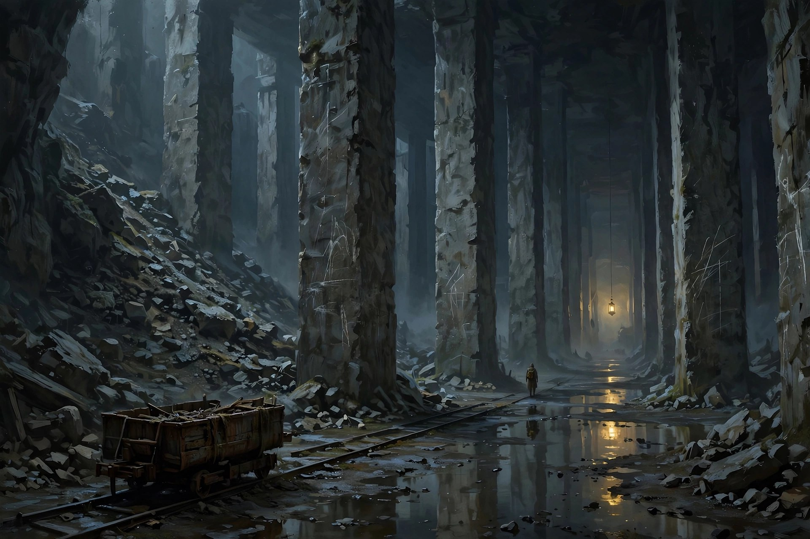
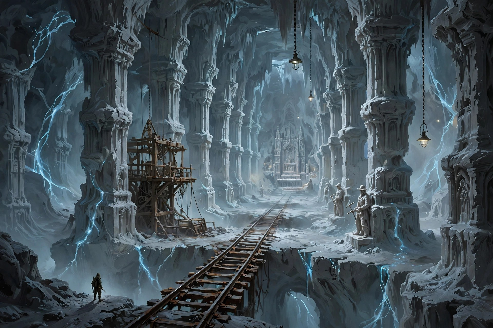

# Dunfinity: the town, grandma's house and levels 1–10 (deep dive)

Status: **draft 2, accepted by Arnd 2026-10-14 (story spine, a grandchild per run, euros + infused salt, the four bands), no code.** Part of [dunfinity-plan.md](dunfinity-plan.md). Builds on [level-generator.md](level-generator.md) and [recipe-box.md](recipe-box.md).

---

## 1. Story spine (proposal)

Everything below hangs on a small, slow story that the player pieces together from cards, camps and places, never from cutscenes.

- **1920s–1940s.** The town's salt mine runs deep. The miners hit a vein of strange, faintly glowing salt. The company calls it "blue salt" and sells it quietly as a remedy.
- **1947.** The mine closes after "an accident" nobody talks about. Grandma's father, a miner, is among those who never came up. She is seven.
- **1959–1966.** Grandma, young and reckless, goes down looking for him, again and again. She learns the place. Her lost cards and camps are from these years (the young, fast handwriting).
- **1966.** Something makes her stop: *the tall one*. She comes back up, bricks up the arch in her cellar, lays the infused-salt circle, and spends sixty years making sure nobody goes down. She writes the careful recipes (the old handwriting), in case someone has to.
- **Thirty years ago** your parents stopped visiting: she was "difficult", wouldn't let anyone into the cellar. You visited once as a child and drew a picture that is still in the tin.
- **2026.** She dies. The salt circle starts to fade. You inherit the house.

What happened to her father, and what the tall one is, stay open as the game's long mysteries.

---

## 2. Each nobody is another grandchild (proposal)

Grandma had a lot of grandchildren. When a nobody dies, the notary's next letter goes to the next one on the list.

- **The notary, Herr Brüggemann,** writes each letter, and grows more weary with every heir. *"Dear Ms. Okafor-Lindqvist, I regret to inform you that you have inherited a house. Please do not go into the cellar. I say this to everyone now."*
- **Each grandchild is generated** with Scale's humans: name, age (19–70), build, look. Purely cosmetic plus, at most, one small quirk (a smoker who coughs in dust; a nurse whose bandages heal more). No stat lottery: it is still pure permadeath (D11).
- The death counter has a home: the notary's list, with names crossed out.

---

## 3. The town (depth 0)

A small town on the edge of a river valley, built from the stone of its own quarry. It's a **hub, not a city**: one main street, the square, grandma's street, maybe 30 buildings, only a handful enterable. A Scale small-town seed (size 0) cut down to that.

**Grandma's house:** a narrow old house, unchanged since the 1980s. Rooms you can walk through: the hall (the notary's letter on the mat), the kitchen (the knife block), the living room (photos that change as you learn the story), the cellar stairs, the cellar, the broken brick wall, the strange room.

**Places in town:**

| Place | What it's for | Tone |
|---|---|---|
| **Pawn shop** (Ilse) | Buys what you bring up: old coins, jewellery, "antiques", oddities from the deep. Pays in euros | Asks no questions, prices things far too low, slowly becomes a collector of the strange |
| **Hardware store** (Kemal) | Sells grounded gear for euros: a helmet with headlamp, gloves, crowbar, rope, a hatchet, a camping stove (a portable fire) | Recommends the wrong thing with total confidence |
| **Neighbour** (old Frau Weber, across the street) | Knew grandma for 60 years; hints, rumours, the occasional photo | Never asks what you're doing in that cellar, always knows |
| **The church and graveyard** | Grandma's grave; later the graves of earlier heirs, with flowers if you visit | Quiet beat between runs |
| **The mine museum** (closed, can be opened) | The town's official history of the mine, with gaps where 1947 should be | Lore |

**Two currencies, cleanly separated:** euros (from selling loot up top) buy *mundane* gear in town; infused salt (from firsts down below) buys *recipes*. They never convert into each other. That gives coming up a reason, and the town a job, without muddying the recipe box.

**Later (not milestone 1):** the town reacts as the seal fails and you go deeper. Things are seen in the streets at night, a neighbour's dog won't go near your house, a crack appears in the church crypt.

---

## 4. Levels 1–10: "Where the miners stopped"

Human-made and huge, getting stranger level by level (L2). In generator terms, the **excavation** process dominates, and natural processes and anomalies take over with depth.

| Levels | Band | What it is | Getting stranger |
|---|---|---|---|
| 1–2 | **The Quarry** | Room-and-pillar limestone workings under the town: endless halls of square pillars, rubble slopes, rails, chalk marks, the town's foundations visible in places | Nothing yet. Just big, dark and quiet. The chalk numbers count *down* |
| 3–5 | **The Salt Works** | The salt mine proper: cathedral chambers carved by miners, salt chapels and statues, brine lakes, lift shafts, wooden headframes, rail bridges over shafts. The first veins of **blue infused salt** | Salt statues face a different way when you look back. Old electric lamps that still work, with no power |
| 6–8 | **The Cisterns** | A forgotten water-works and wartime bunker built into the mine: vast flooded pillar halls, pump rooms, a bunker with 1940s furniture, machinery | Water flows uphill in places. Some pillars are older than the cistern: someone built on top of something |
| 9–10 | **The Threshold** | Natural caverns break through. The first ruins that are clearly not modern: a crypt facade, a stair carved too large for people | Geometry older than humanity. Grandma's first camp (a tent, a thermos, a note). The tall one |

*The Quarry, levels 1–2 (concept sketch).*

*The Salt Works, levels 3–5 (concept sketch).*

**Light:** man-made light at first (old electric lamps, miners' lamps, your headlamp), then the **blue glow of infused salt** veins (the signature light of this stratum), then bioluminescence from 9.

**Inhabitants** (layer 3 of the generator): the miners' leftovers (shacks, lifts, rails, signs, chapels), a few people who live down there now (scavengers, a hermit), and in the Cisterns the wartime bunker.

---

## 5. Creatures of levels 1–10

| Creature | Levels | What it does | Reuse |
|---|---|---|---|
| **Rats** | 1–4 | Swarms. Individually pathetic, together not | Scale Brood swarm sim |
| **Cave crickets** (dog-sized) | 1–5 | Leap from walls and ceilings, scatter in light | Norgo creature genome (hexapod) |
| **Slimes** (Lumen and Murk) | 2–8 | Two factions at war with each other; Lumen may tolerate you | Scale `deep` factions, nearly as is |
| **The Salt-Touched** | 3–8 | The lost miners, changed: crystal growths, slow, hits very hard, carries old mining tools. Infused salt grows on them | Scale humans + crystal shells; Norgo AI |
| **Brine things** | 5–8 | Eels and worse in the flooded halls | Norgo genome (serpentine, finned) |
| **Feral dogs** | 6–8 | Packs in the bunker, flank | Scale DogPack |
| **Scavengers** | 4–10 | People living down there; some trade, some rob. Loot your corpse | Scale humans |
| **The Foreman** (boss) | 5 | A huge Salt-Touched in the salt cathedral, with a mine bell he rings to call the others | Scale threat zones / weak spots, Caster tells |
| **The Tall One** (boss) | 10 | Gaunt, four metres, quiet. Does not cross infused salt (grandma's Salt Line). Guards the Threshold | Caster, Norgo genome (biped) |

Quaternius Ultimate Monsters from AssetGenerator can stand in for the genome creatures while those are built.

---

## 6. Pacing of levels 1–10

- **First minute:** cellar, tin, knife, the first card. **First fight within two minutes** (a rat).
- **Typical first death:** levels 3–5 (the Salt Works). The Foreman is the first real wall.
- **Way Home (Recall)** becomes affordable around level 8.
- **Level 10** is the end of the first stratum: the Tall One, then the first truly natural, truly strange caverns. A good first-milestone finish line.

---

## 7. Questions

1. **Story spine** (the 1947 accident, grandma's father, the tall one) **(my pick)**?
2. **Each nobody is another grandchild**, with the weary notary **(my pick)**?
3. **Euros for mundane gear in town, infused salt for recipes**, never mixing **(my pick)**, or salt only?
4. **The four bands** (Quarry, Salt Works, Cisterns, Threshold) **(my pick)**?
